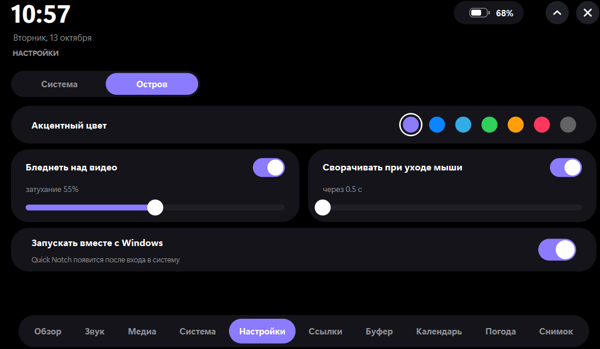

# Quick Notch

Quick Notch is a compact Windows utility panel that opens above the desktop at the top center of the screen. It provides quick access to essential system tools, shortcuts, and lightweight widgets without opening separate windows.

The interface features smooth animations, rounded corners, and a compact layout: the selected tool is shown on the left, while a vertical section panel is displayed on the right.

## Screenshots

| Collapsed panel | Settings |
| --- | --- |
|  |  |

## Features

- Shows the current time and battery level.
- Lets you quickly launch the browser, File Explorer, Notepad, and Calculator.
- Controls system volume and Windows media keys.
- Toggles Wi‑Fi and Bluetooth using the Windows Radios API (when supported by the device and permitted by Windows).
- Opens settings for display, Night Light, notifications, and sound.
- Displays CPU, memory, and system disk usage.
- Supports custom links to websites, folders, and applications.
- Keeps a local clipboard history while the relevant section is open.
- Shows reminders based on app runtime.
- Fetches weather for a selected city via Open-Meteo after a button press.
- Can start with Windows via a checkbox in the interface.

## Running the app

First, install the project dependencies in a virtual environment:

```powershell
..\.venv\Scripts\python.exe -m pip install -r requirements.txt
```

After that, start the app by double-clicking `run.bat`.

If there is no virtual environment yet, install dependencies with the system Python 3:

```powershell
py -3 -m pip install -r requirements.txt
```

Then run `run.bat`.

## Usage

- Click the panel to expand it smoothly.
- Use the arrow to collapse it.
- Press the `×` button to close the application.

## Project structure

- `main.py` — application entry point.
- `island.py`, `sections.py`, `dialogs.py` — main panel window, sections, and dialogs.
- `theme.py`, `spring.py`, `ui.py` — colors, animation, and interface elements.
- `bg.py`, `store.py`, `winapi.py`, `winrt_api.py` — background tasks, data storage, and Windows system integrations.
- `requirements.txt` — project dependencies.
- `run.bat` — launches the app without a console window.

## Notes

- Quick links are stored in `%APPDATA%\QuickNotch\links.json`.
- Clipboard history and reminders are not saved after the application closes.

## Requirements

- Windows
- Python 3
- Access to Windows system APIs for some features (Wi‑Fi, Bluetooth, media controls, etc.)
